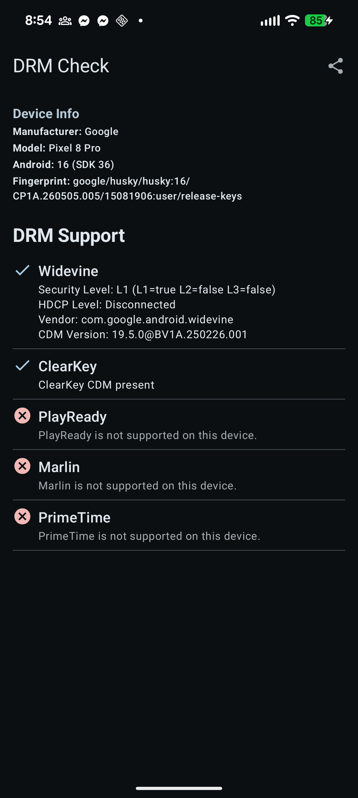

# CheckDrmInfo

[](https://github.com/jpcottin/CheckDrmInfo/actions/workflows/ci.yml)
[](https://github.com/jpcottin/CheckDrmInfo/actions/workflows/instrumented-tests.yml)
[](https://github.com/jpcottin/CheckDrmInfo/actions/workflows/release.yml)

<details>
<summary><b>CI details</b> — emulator matrix, API 30 → 37.2, plus Android CLI and Emulator Preview legs</summary>

Instrumented tests run on GitHub-hosted emulators (`google_apis` images — Widevine present, unlike AOSP `default` images):

| Legs | Image | Emulator channel | GPU | Gating |
|---|---|---|---|---|
| API 30, 33, 36 | `google_apis` x86_64 | stable | lavapipe / auto | ✅ blocking |
| API 37.0 | `google_apis_ps16k` (16 KB page size) | stable | lavapipe | non-blocking |
| API 37.0 | `google_apis_ps16k` | canary (`--channel=3`) | lavapipe, auto | non-blocking |
| API 37.1 | `google_apis_ps16k` | canary | lavapipe, auto | non-blocking |
| API 37.2 | `google_apis_ps16k` | canary | lavapipe, auto | non-blocking |
| Android CLI experiment | `google_apis_ps16k` 37.0, 37.2 | canary | emulator default | non-blocking |
| Emulator Preview (`emulators;latest`) | `google_apis_ps16k` 37.0, 37.1, 37.2 | preview package | auto | non-blocking |
| Emulator Preview multi-run (snapshot cycles) | `google_apis_ps16k` 37.0 | preview package | auto | non-blocking |
| Android CLI multi-run (snapshot cycles) | `google_apis_ps16k` 37.0 | canary | emulator default | non-blocking |

The Android CLI leg drives the whole flow with the [`android` CLI](https://d.android.com/tools/agents/android-cli) (`android sdk install --canary`, `android emulator create/start/stop`) instead of `sdkmanager`/`avdmanager` and the emulator-runner action.

Two of the non-blocking jobs run a **snapshot multi-run experiment**: the emulator is booted four
times against the same AVD with quickboot snapshots enabled, the app is launched only on the first
cycle, and every later cycle checks whether the snapshot brought it back by itself — still running,
and still rendering. The app is deliberately never relaunched after a restore, since that is the
thing being measured. One job drives the Emulator Preview package, the other the canary emulator
through the `android` CLI, so the same experiment can be compared across both.

Because this app's UI is static, rendering is judged with `android layout` rather than by diffing
two screenshots — a screenshot diff would report a stall on every cycle. A non-empty layout tree
plus a focused window means the UI is present and enumerable. Screenshots are still captured and
uploaded for every cycle. `scripts/replay-preview-multirun.sh` replays the multi-run job locally in
a few minutes instead of a push cycle.

All emulator-runner legs use full diagnostics (`-verbose -show-kernel -debug-metrics -metrics-collection`) and a `cmdline-tools;latest` update so `avdmanager` writes a valid `target=android-37.x` (the runner's preinstalled version writes `android-0`, which the emulator clamps to API 3, disabling the Vulkan/GLDirectMem auto-enable the ps16k images need).

</details>

An Android app that probes which DRM (Digital Rights Management) systems are present and active on a device, along with detailed capability information where available.

## What it checks

| DRM System | UUID | Used by |
|---|---|---|
| Widevine | `EDEF8BA9-79D6-4ACE-A3C8-27DCD51D21ED` | Google / most Android streaming |
| ClearKey | `E2719D58-A985-B3C9-781A-B030AF78D30E` | W3C open standard |
| PlayReady | `9A04F079-9840-4286-AB92-E65BE0885F95` | Microsoft |
| Marlin | `5E629AF5-38DA-4063-8977-97FFBD9902D4` | Sony / Amazon select devices |
| PrimeTime | `F239E769-EFA3-4850-9C16-A903C6932EFB` | Adobe broadcast streaming |

For Widevine, the app additionally reports:
- Security level (L1 / L2 / L3)
- HDCP output level
- CDM vendor string
- CDM version

## Screenshots

Pixel 8 Pro — Android 16 (SDK 36):



- Widevine L1, HDCP level reflects connected output (Disconnected when no HDMI)
- ClearKey present (standard on all Android devices)
- PlayReady, Marlin, PrimeTime not supported (expected on stock Google devices)

## Architecture

The project was refactored from a single-activity app into a layered structure:

```
app/src/main/java/com/example/checkdrminfo/
├── MainActivity.kt              # just onCreate + theme
├── DRMChecker.kt                # MediaDrm probing; injectable factory for testability
├── DRMViewModel.kt              # viewModelScope + Dispatchers.IO; injectable dispatcher
├── model/
│   └── DrmInfo.kt               # DrmResult sealed class, DrmEntry, DrmInfoState, DeviceInfo
└── ui/
    ├── DrmComponents.kt         # Stateless composables + previews
    └── DrmInfoScreen.kt         # Adaptive layout + screen-level previews
```

### Adaptive layout

`currentWindowAdaptiveInfo()` drives the layout:
- **Compact width** (phone portrait) → single scrollable column
- **Medium / Expanded width** (tablet, foldable, landscape, TV) → two-pane: device info on the left, DRM list on the right

### State management

`DRMViewModel` exposes a single `StateFlow<DrmInfoState>`. All five DRM checks run concurrently via `async`/`await` on `Dispatchers.IO` and collapse into a single state update.

## Requirements

- **minSdk 30** (Android 11) — `MediaDrm.use {}` requires API 28+; Widevine property APIs are stable from 30
- **targetSdk 35**

## Tests

| Suite | Count | Notes |
|---|---|---|
| `DRMCheckerTest` | 24 | All 5 DRM systems × not-supported / exception / supported; Widevine security level, HDCP and version details, property-query failures (the scheme stays supported, the details carry the error) and N/A fallbacks; the MediaDrm handle (not opened for an unsupported scheme, a failing constructor reported by name, released even when a property read crashes); a message-less exception named by its class |
| `DRMViewModelTest` | 16 | `MainDispatcherRule` + `kotlinx-coroutines-test`; shareable report layout and the still-checking marker; the loading placeholders and the declared entry order; one scan at a time |
| `DeviceInfoTest` | 3 | `DeviceInfo` default-value safety |
| `PreviewScreenshotTests` (screenshot) | 4 | Compose Preview screenshot tests, `validateDebugScreenshotTest` against the recorded references |
| `DrmUiTest` (instrumented) | 9 | Compose UI tests for all component states |

Run unit tests:
```
./gradlew test
```

Run instrumented tests (device or emulator required):
```
./gradlew connectedAndroidTest
```

Three workflows run on GitHub Actions: `ci.yml` (debug build, unit tests, screenshot
validation and lint on every push and pull request, with the `unit-test-results` and
`lint-report` artifacts, plus `screenshot-test-report` when the validation fails), `instrumented-tests.yml` (the emulator
matrix described above) and `release.yml` (`assembleRelease` plus a GitHub release on a
version tag).

## Build

```
./gradlew installDebug
```
